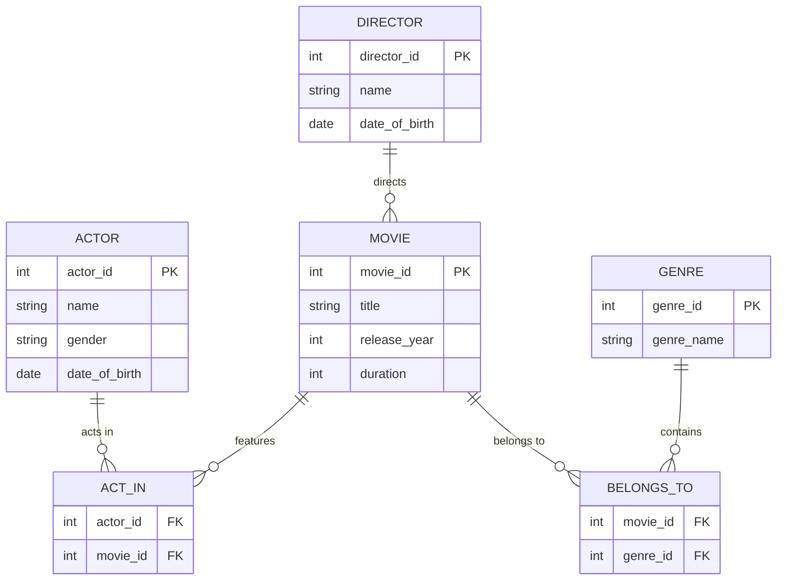

# SQL Movie Database Management System

## About Project
This project is developed using Oracle SQL to manage movie-related information. It stores and manages details about movies, actors, directors, and genres using relational database concepts.

## ER Diagram

## Technologies Used
- Oracle SQL
- Oracle Live SQL
- DBMS

## Database Tables
1. ACTOR
2. DIRECTOR
3. GENRE
4. MOVIE
5. ACT_IN
6. BELONGS_TO

## Concepts Used
- CREATE TABLE
- PRIMARY KEY
- FOREIGN KEY
- CHECK Constraints
- INSERT Queries
- SELECT Queries
- JOIN Operations

## Author
- Ravi Pratap Vishwakarma
- Sahil Rana
- Sahil
